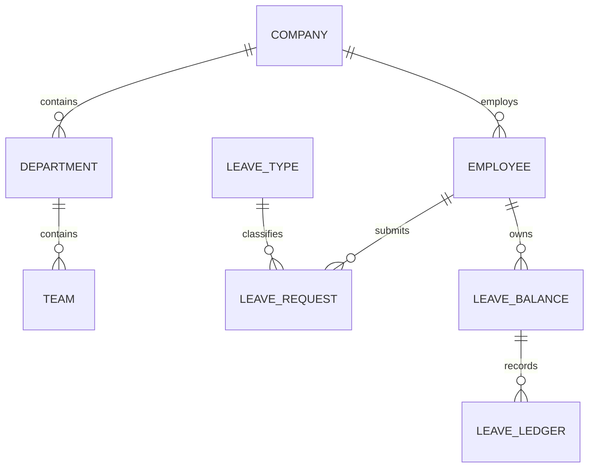

# Database model

The active application uses company tenancy; business units, departments, teams and designations; users, roles, permissions and assignments; employees and effective-dated reporting relationships; leave types/policies/balances/ledger/requests/approvals; holiday calendars; and audit logs. Legacy attendance tables remain in the Prisma schema solely to retain existing historical records. Attendance pages and API routes are retired; removing the legacy tables and their data requires a separate, approved data-retention decision.

Key constraints: company slug unique; org names unique within company; employee code unique per company; one leave balance per employee/type/year; one holiday per calendar/date. Leave requests support optional partial-day start/end times and fractional working-day units. Preserve historical records; do not drop legacy attendance tables in a routine push.

Validate schema with Prisma and generate reviewed SQL migrations before production; do not use `db push` as the production migration strategy.
